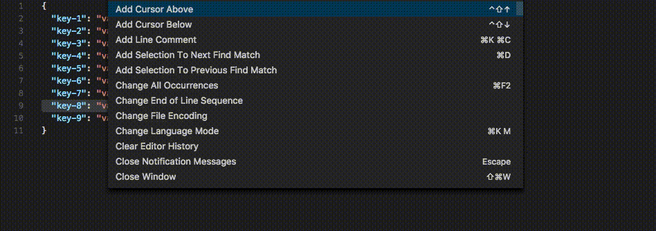

# Sublime Text Duplicate for VSCode

Mirrors Sublime Text's duplicate behavior in VS Code:

- **With selection** — duplicates the selected text inline
- **Without selection** — duplicates the entire current line
- Supports multiple cursors/selections simultaneously

## Usage

Press `⌘+Shift+D` (Mac) or `Ctrl+Shift+D` (Windows/Linux) to duplicate text.

You can also run it from the command palette (`⌘+Shift+P` / `Ctrl+Shift+P`): search for **Sublime Duplicate Text**.



## Keybindings

This extension registers the following shortcut automatically:

```json
[
  {
    "mac": "cmd+shift+d",
    "key": "ctrl+shift+d",
    "command": "sublime-duplicate-text.duplicateText",
    "when": "editorTextFocus"
  }
]
```

## Development

### Prerequisites

- Node.js 18.x or 20.x
- npm or yarn

### Setup

```bash
npm install        # Install dependencies
npm run compile    # Compile TypeScript
npm run watch      # Watch mode
npm test           # Run tests
npm run lint       # Lint
npm run format     # Format
```

### Project Structure

```
.
├── src/              # TypeScript source files
│   └── test/         # Test suite
├── out/              # Compiled JavaScript (gitignored)
├── .github/          # CI/CD workflows
└── package.json      # Extension manifest
```

## Contributing

Contributions are welcome! Please see [CONTRIBUTING.md](CONTRIBUTING.md) for guidelines.

## Version History

See [CHANGELOG.md](CHANGELOG.md) for detailed version history.

## License

MIT — Copyright (c) 2017 Brian Anders
